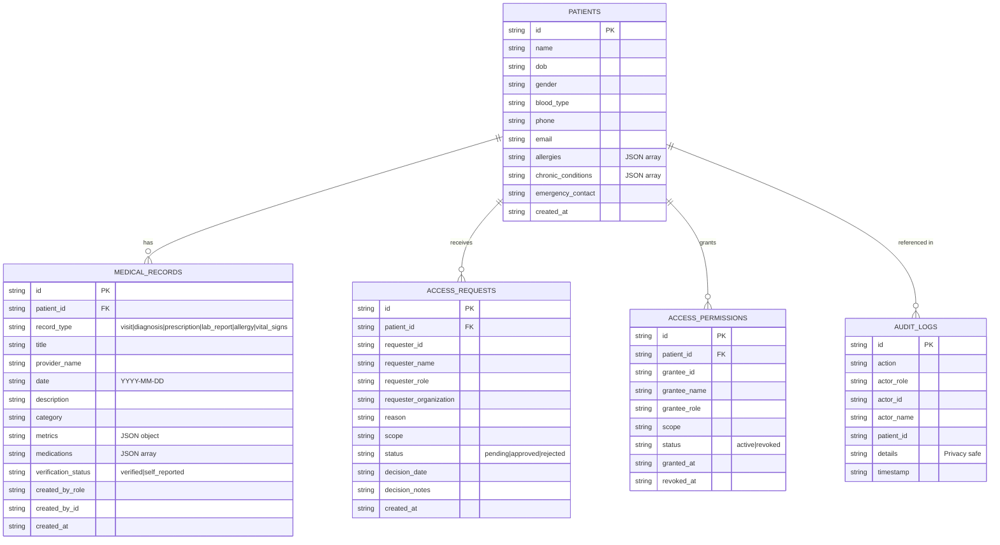

# MedIt — Unified Patient Health Records Platform

> **Hackathon Prototype MVP** — Demonstrating how fragmented medical records from hospitals, clinics, and diagnostic laboratories are unified into a verified chronological patient health timeline with backend-enforced patient consent governance.

---

## 🏥 Project Overview

In the modern healthcare ecosystem, patient records are scattered across general hospitals, neighborhood outpatient clinics, and private diagnostic laboratories. Patients struggle to access their complete history, and doctors often lack vital cross-institutional context (e.g. allergies, previous lab results, current prescriptions).

**MedIt** solves this by providing:
1. **Unified Chronological Timeline**: Centralizing visits, diagnoses, prescriptions, lab reports, and vitals across all healthcare providers.
2. **Source & Verification Tracking**: Clear attribution of records (e.g., *St. Jude Medical Center*, *Apex Diagnostics Laboratory*, *Metro Health Clinic*, or *Self-Reported*).
3. **Simulated Zero-Trust Patient Consent**: Doctors cannot view a patient's historical records until affirmative patient consent is granted in the backend.
4. **HIPAA-Safe Operational Audit Logs**: Immutable logging of all access requests, grants, revocations, and views without leaking sensitive clinical descriptions.

---

## 💻 Technology Stack

| Layer | Technology | Description |
|---|---|---|
| **Frontend** | React 19 + Vite | Fast, responsive single-page application |
| **Styling** | Tailwind CSS v4 + Lucide Icons | Dark medical green (`#0B3724`), white cards, mint accents |
| **Backend** | Python 3 + Flask REST API | Lightweight, modular REST service |
| **Data Validation** | Pydantic v2 | Strict schema validation for patients, records, and requests |
| **Database** | SQLite3 (`medit.db`) | Relational persistence with foreign keys & indexes |
| **Testing** | Pytest | 6 automated tests covering search, validation, sorting, access denial, consent, and audit |

---

## 👥 Demo Personas & Roles

MedIt features a top-level **Demo Persona Switcher** allowing instant live demonstration of all three healthcare roles:

1. **Patient Portal — Sarah Jenkins (`PAT-101`)**
   - View demographic summary (DOB: 1988-04-12, Blood Type: O+).
   - High-contrast clinical warnings: **Penicillin allergy**, **Essential Hypertension**, **Mild Asthma**.
   - Review unified chronological timeline.
   - Review pending doctor access requests (e.g., from *Dr. Marcus Vance*).
   - **Approve** or **Reject** access requests in one click.
   - View active consents and **Revoke** access at any time.
   - Add self-reported vitals or clinical records.

2. **Doctor Workstation — Dr. Marcus Vance (`DOC-201`, Cardiologist)**
   - Search for patients by ID (`PAT-101`, `PAT-102`, `PAT-103`).
   - **Access Control Shield**: When consent is not yet granted, protected clinical records are blocked (HTTP 403) with a "Patient Consent Required" screen.
   - Submit formal clinical access requests with rationale and scope.
   - When consent is granted: Unlocks complete multi-provider timeline, diagnoses, lab panels, and active medications.
   - Filter records by category (*Visits*, *Diagnoses*, *Prescriptions*, *Lab Reports*, *Allergies*).
   - Author and sign new clinical records into the unified timeline.

3. **Healthcare Provider Portal — Apex Diagnostics Laboratory (`PROV-301`)**
   - Certified clinical laboratory portal.
   - View incoming inter-provider clinical sharing requests.
   - Approve/dispatch or decline record sharing requests.
   - Author and publish verified diagnostic laboratory panels with structured metrics.
   - Review real-time operational audit trail.

---

## 🔒 Privacy & Security Safeguards

- **Simulated Demo Notice**: Clearly marked as an educational hackathon prototype (not for clinical use).
- **Backend-Enforced Authorization**: Access checks are validated on the Flask API endpoints, not just hidden in the frontend.
- **Patient Consent Enforcement**: `GET /api/patients/<id>/records` returns `403 Forbidden` for doctor requests unless an active permission row exists in `access_permissions`.
- **Privacy-Safe Audit Logging**: Operational events (search, access, consent grant, revoke) are logged with actor and timestamp, but raw clinical notes and diagnosis text are excluded to prevent HIPAA privacy leaks.
- **Fictional Demo Data**: All patient names, medical descriptions, and provider identities are purely fictional.

---

## 🚀 Getting Started & Execution (Windows)

### Prerequisites
- Python 3.10+ (tested on Python 3.14)
- Node.js v18+ & npm (tested on Node v24)

---

### Step 1: Backend Setup & Execution (Terminal 1)

Open PowerShell and navigate to the project root:

```powershell
cd c:\Users\farzz\Downloads\medit_health_records

# 1. Create Python virtual environment (if not already created)
python -m venv backend\venv

# 2. Activate virtual environment
.\backend\venv\Scripts\Activate.ps1

# 3. Install backend dependencies
pip install -r backend\requirements.txt

# 4. Initialize and seed demo database
python backend\seed_data.py

# 5. Run Pytest automated test suite
pytest backend\tests\test_medit.py -v

# 6. Start Flask REST API server (Runs on port 5000)
python backend\app.py
```

The Flask API will start and display:
```
* Running on http://127.0.0.1:5000
```

---

### Step 2: Frontend Setup & Execution (Terminal 2)

Open a second PowerShell terminal:

```powershell
cd c:\Users\farzz\Downloads\medit_health_records\frontend

# 1. Install frontend dependencies
npm install

# 2. Run Vite development server
npm run dev
```

The development server will start and display:
```
  VITE v8.3.5  ready in 493 ms

  ➜  Local:   http://localhost:5173/
```

Open your browser and navigate to:
**👉 http://localhost:5173/**

---

## 🧪 Automated Testing (Pytest)

Run the test suite from the repository root:

```powershell
.\backend\venv\Scripts\pytest.exe backend\tests\test_medit.py -v
```

### Test Coverage Highlights:
- `test_patient_search_and_lookup`: Search by name/ID and demographic profile retrieval.
- `test_medical_record_creation_and_validation`: Pydantic schema validation for valid payloads, blank fields, invalid dates, and non-existent patients.
- `test_chronological_sorting`: Verifies newest records appear first.
- `test_unauthorized_doctor_record_access`: Verifies unauthorized doctor gets `403 Forbidden` with `consent_required: True`.
- `test_access_denial_and_consent_based_access_flow`: End-to-end test of Doctor Request ➡️ Patient Rejection ➡️ Re-request ➡️ Patient Approval ➡️ Doctor 200 OK view ➡️ Patient Revoke ➡️ Doctor 403 Forbidden.
- `test_audit_log_creation_and_privacy`: Verifies operational events are logged without exposing sensitive clinical descriptions.

---

## 🗄️ Database Architecture (`medit.db`)



---

## 🎬 Recommended 3-Minute Live Hackathon Demo Walkthrough

1. **Step 1: Patient Dashboard (`Sarah Jenkins - PAT-101`)**
   - Notice the dark medical green interface, demographic snapshot, Penicillin allergy alert, and unified timeline containing records from **St. Jude Medical Center**, **Apex Diagnostics Laboratory**, and **Metro Health Clinic**.
   - Notice the amber notification card: **"Doctor Access Requests Pending Your Consent"** from *Dr. Marcus Vance*.

2. **Step 2: Doctor Workstation (`Dr. Marcus Vance - DOC-201`)**
   - Switch persona to **Dr. Marcus Vance**.
   - Observe the **"Clinical Health Timeline is Shielded"** access guard. Even though Dr. Vance is a licensed cardiologist, MedIt enforces that patient consent is required.
   - Click the shortcut: **"Switch to Patient Persona (Sarah Jenkins) to Approve"**.

3. **Step 3: Patient Consent Decision**
   - Click **"Approve Access"** on Dr. Vance's request.
   - A success toast confirms consent has been authorized and an immutable audit entry is written.

4. **Step 4: Unlocked Doctor Workstation**
   - Switch back to **Dr. Marcus Vance**.
   - The timeline is now unlocked with **"Consent Active: Access Granted"**!
   - Filter by **Lab Reports** to review fasting blood sugar and cholesterol levels.
   - Click **"Author Clinical Record"** to simulate ordering a follow-up test.

5. **Step 5: Healthcare Provider Portal & Audit Trail**
   - Switch to **Apex Diagnostics Lab**.
   - Inspect incoming inter-provider sharing requests and approve a dispatch.
   - Open **"Sharing & Audit Logs"** in the sidebar to review the simulated HIPAA-compliant audit trail.
   - Click **"Reset Demo Data"** in the top navigation bar to reset the database at the end of the demonstration.
